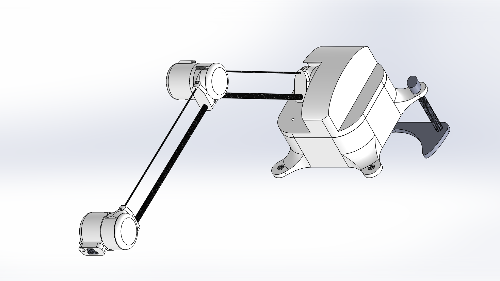
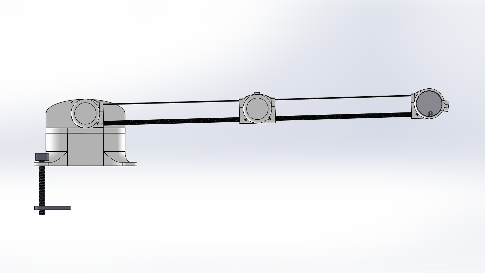
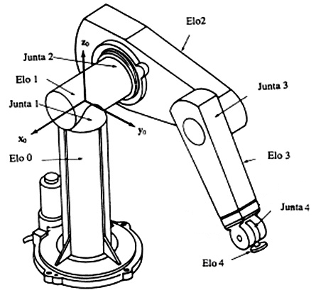
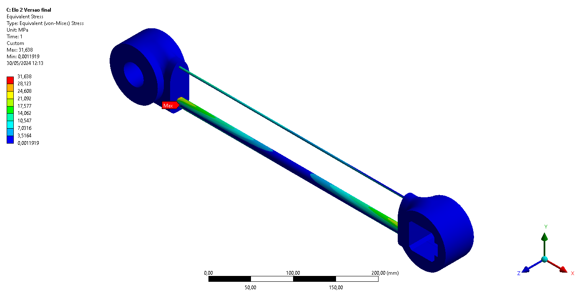

<h1 align="center">Eduardo Larsen Güths</h1>

  <b>Master's Student in Neuroscience (PPGNeuro · UFSC)</b> — Brain-Computer Interfaces 
  Decoding movement from EEG · 3D Modeling · Low-Cost Prototyping  
  From CAD to neural networks: end-to-end engineering applied to <b>prosthetic hands</b>.

---

## 🧠 In focus: BCI for a Bionic Hand (Master's Project)

**Decoding 3D hand trajectories from EEG** to control a prosthesis — Master's in Neuroscience (PPGNeuro · UFSC), with the data collection protocol **approved by the UFSC Research Ethics Committee (CEP)**.

➡️ **[Mestrado-Kinect-EEG-Trajectory](https://github.com/educapeta/Mestrado-Kinect-EEG-Trajectory)**

What's in the repository:

- **Offline EEG acquisition** — g.Nautilus (32 channels, 500 Hz), ME/MI protocol with 6 conditions, markers with the exact EEG sample index and EEG↔motion synchronization via a shared monotonic clock
- **Multimodal hand ground truth** — Kinect v2 (RGB + depth), stereo-calibrated auxiliary webcams (reprojection error < 1.5 px), and **two inertial gloves** (ESP32 + MPU6050) with versioned firmware
- **SAND neural network** — sparse attention + convolutions: 2 s EEG window → 3D trajectory (30 × 3), with position/velocity targets and an anatomical regularizer
- **Online system** — asynchronous inference with the predicted trajectory overlaid on video, plus a Kalman filter fusing decoded velocity with IMU acceleration
- **~27 test suites** runnable without hardware, including end-to-end synthetic sessions

---

## 🦾 Low-Cost Anthropomorphic Arm (Undergraduate Thesis)

**"Prototipagem e análise estática de um braço antropomórfico de 4 GDL"** — Undergraduate thesis (TCC) in Mechanical Engineering, UFSC (2024), supervised by Prof. Rodrigo de Souza Vieira (co-supervision: Esdras S. da Silva).

Development of a **4-degree-of-freedom anthropomorphic arm** to simulate human arm motion: kinematic modeling, simulation, structural optimization of components, and a prototype built via **3D printing** — aiming to replicate common object-grasping movements, applying human tactile sensing technologies to upper-limb prostheses.

In collaboration with the **Robotics Lab (LAR)**, the **Biomedical Engineering Institute (IEB)**, and the **Integrated Circuits Lab (LCI)** at UFSC.

 

### 🔗 Resources

- **Thingiverse (3D-printable files):** [Antrophomorfic Arm 4DOF](https://www.thingiverse.com/thing:6723166) · [All designs](https://www.thingiverse.com/Educapeta/designs)
- **Full thesis (PDF, 146 pages):** [assets/tcc/tcc_thesis_eduardo_larsen_guths_2024.pdf](assets/tcc/tcc_thesis_eduardo_larsen_guths_2024.pdf)

---

## 🧩 3D Modeling Portfolio

<table>
<tr>
<td width="230" align="center">
  
</td>
<td>
  <h3>🏠 <a href="https://github.com/educapeta/projetos-para-casa">Home Projects</a></h3>
  <b>20 designs</b>, each in its own folder with <b>README and preview image</b>: guitar
  capotraste with rack-and-pinion, monotub, cheese press and Camembert mold, volleyball
  net tensioner, water pump, phone clips and tripods, organizers, filament holders,
  bruxism plate, insulated reservoir, tolerance tester, and more.
    
  <b>181 files</b> · <code>.SLDPRT</code> <code>.SLDASM</code> <code>.STL</code> <code>.ipt</code> <code>.gx</code> <code>.fpp</code>
</td>
</tr>

<tr>
<td width="230" align="center">
  
</td>
<td>
  <h3>🍺 <a href="https://github.com/educapeta/projetos-para-cervejaria">Brewery Projects</a></h3>
  <b>Carbonator</b> system for the Cerveja Fácil / AgroKeg project (cap, gas base,
  O-ring pins, nuts and spring), flexible version with tap, O-ring molds, adapters,
  sparge, thermometer holder, and fermenter tap guide.
    
  <b>107 files</b> · <code>.SLDPRT</code> <code>.SLDASM</code> <code>.SLDDRW</code> <code>.STL</code> <code>.gx</code> <code>.fpp</code>
</td>
</tr>

<tr>
<td width="230" align="center">
  
</td>
<td>
  <h3>🔧 <a href="https://github.com/educapeta/equipamentos-saulo">Equipment</a></h3>
  <b>Sheet-metal enclosures</b> with flat patterns for laser cutting (Air Safe Model 1
  and 2, with technical drawings and assembly videos), 3D-printed boxes (DUPLAC V1/V2),
  CO₂ meter enclosure, motorcycle case, buckles, lamp holder, and finishing parts.
    
  <b>133 files</b> · <code>.SLDPRT</code> <code>.DXF</code> <code>.PDF</code> <code>.IGS</code> <code>.stp</code>
</td>
</tr>

<tr>
<td width="230" align="center">
  
</td>
<td>
  <h3>🦾 <a href="https://github.com/educapeta/trabalho-final-metodologia">Mechanical Actuator (Course Project)</a></h3>
  Mechanical system of links and levers inspired by an accelerator handle, with gripper
  and tweezers. Includes final assembly, technical drawings of the parts, and the
  project specification report.
    
  <b>21 files</b> · <code>.SLDPRT</code> <code>.SLDASM</code> <code>.SLDDRW</code> <code>.docx</code>
</td>
</tr>

<tr>
<td width="230" align="center">
  <a href="https://github.com/educapeta/motorhome">
    
🚐

  </a>
</td>
<td>
  <h3>🚐 <a href="https://github.com/educapeta/motorhome">Motorhome</a></h3>
  Sink designed to maximize the limited counter space of a vehicle — parametric model
  with STL ready for 3D printing.
    
  <b>6 files</b> · <code>.SLDPRT</code> <code>.STL</code>
</td>
</tr>

<tr>
<td width="230" align="center">
  <a href="https://github.com/educapeta/confortimetro">
    
🌡️

  </a>
</td>
<td>
  <h3>🌡️ <a href="https://github.com/educapeta/confortimetro">Confortímetro</a></h3>
  3D modeling of the comfort meter development project.
    
  <b>5 files</b> · <code>.SLDPRT</code>
</td>
</tr>
</table>

💡 Opening any `.stl` file in a GitHub repository renders the part in 3D. 🖨️

---

## 🛠️ Tools & Formats

`SolidWorks 2017` · `FlashPrint` · `Fusion 360` · `AutoCAD/DXF` · `Inventor` ·
`Python` (NumPy · PyTorch · OpenCV · MediaPipe) · `PlatformIO/ESP32` · `Kinect SDK 2.0` ·
`STL` (3D printing) · `DXF` (sheet metal) · `STEP / IGES / x_t` (CAD interchange) · `Git LFS`

## 📄 License

3D models are my own work, released under **CC BY-NC-SA 4.0** — use, print, and adapt
with attribution, non-commercial only. For commercial use, contact me.

---

<i>Opening an <code>.stl</code> file in any repository lets GitHub display the part in 3D. 🖨️</i>

